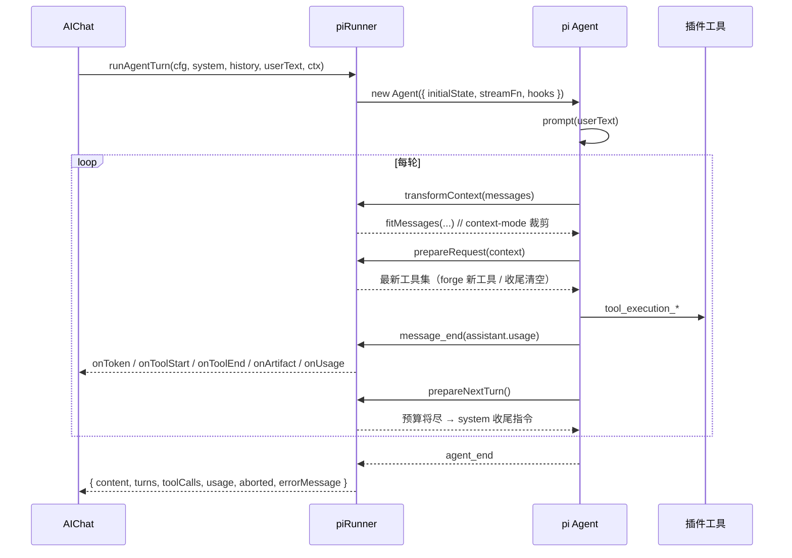

# Lumia Agent 设计规范（pi-agent-core 完整接入版）

> 目标：一次提问 = 一个可观测、可中断、有预算、可扩展的 Agent 运行。
> 原则：**能用 pi core 的钩子解决，就不要在 UI 层重造。**

## 1. 分层

| 层       | 本项目位置                                     | 职责                                                |
| -------- | ---------------------------------------------- | --------------------------------------------------- |
| UI       | `src/components/AIChat.tsx` / `AgentPanel.tsx` | 渲染、输入、状态栏；**不参与**提示词与工具循环      |
| 运行器   | `src/lib/agent/piRunner.ts`                    | 组装 Agent、订阅事件、预算/收尾、usage 统计         |
| 模型适配 | `src/lib/agent/piLlm.ts`                       | OpenAI 兼容端点 ↔ pi-ai 的流式/工具协议             |
| 插件     | `src/lib/agent/plugins/*Plugin.ts`             | 工具 + 提示词 + 卡片 UI + 守卫（自描述）            |
| 提示词   | `src/lib/skills/*`                             | 按轮次 just-in-time 组装 system（context 段可压缩） |
| 存储     | `artifacts / kb / todos / anki / contextMode`  | 纯数据 + 纯函数，localStorage 落盘                  |

## 2. 一次运行的完整生命周期



## 3. pi core 钩子映射（关键）

| 钩子               | 本项目用途                                | 解决的问题                            |
| ------------------ | ----------------------------------------- | ------------------------------------- |
| `transformContext` | `fitMessages()` 按字符预算裁剪 transcript | 长会话 token 失控（context-mode）     |
| `prepareRequest`   | 刷新工具注册表；收尾阶段 `tools=[]`       | AI 自建插件当轮生效；预算用尽强迫总结 |
| `prepareNextTurn`  | 注入【收尾】system 消息                   | **「查一半就停」**：不再硬中断        |
| `beforeToolCall`   | 计数 + `guardTool()`（联网/配置守卫）     | 预算、权限、失败可解释                |
| `finishTurn`       | 轮次计数，达到上限 `agent_end`            | 防死循环                              |
| `subscribe`        | `message_update/end`、`tool_execution_*`  | 流式、工具状态、usage                 |
| `abort`            | `signal` 透传                             | 用户中止                              |

### 预算（`BUDGET`）

| 模式 | 轮数 | 工具调用 |
| ---- | ---- | -------- |
| fast | 5    | 8        |
| auto | 10   | 20       |
| deep | 16   | 36       |

规则：

1. 达到 `calls` → 工具调用被 block（**不 terminate**），下一轮自动收尾；
2. 剩余 ≤2 轮 或 剩余 ≤4 次工具 → `prepareNextTurn` 注入收尾指令；
3. 收尾轮 `tools=[]`，模型必须用文字总结；
4. 若仍无正文：返回明确提示（不再静默停止）。

## 4. 插件协议（`AgentPlugin`）

```ts
{
  id, name, priority?, web?,
  tools(ctx): AgentTool[],          // 纯声明，execute 内才读 ctx
  promptLines?(ctx): string,        // 工具说明（自动拼进【原生工具】段）
  systemSection?(ctx): SkillSection // 插件自带 system 段
  ui?: Record<tool, { type, tab }>, // 工具卡（消息内已不渲染，仍用于日志/面板）
  resolveUi?(name),                 // 动态工具（forge）UI
  guard?(ctx, toolName?),           // 可用性拒绝原因
  tagPatterns?: RegExp[],           // 旧 [TAG:] 通道清洗
}
```

自动发现：`import.meta.glob("./*Plugin.ts", { eager: true })`，按 `priority` 排序。
新增能力 = 新增一个文件；**不改核心**。

## 5. 提示词组装

- 位置：`skills/registry.ts#assembleSystem`
- 只有「当轮相关」的段被注入；上下文段各自 `clamp`，指令段不裁。
- 插件通过 `promptLines` / `systemSection` 参与，不需要改 registry。
- 顺序：knowledge → siteDoc → persona → memory → web → view → mode → tools → quality → artifacts → kb → 插件段 → (live2d / tts)。

## 6. 产物策略（反刷屏）

| 动作                                         | 是否落产物             |
| -------------------------------------------- | ---------------------- |
| `web_search` / `fetch_page` / `image_search` | ❌ 只回给模型          |
| `open_webpage` / `generate_article`          | ✅ 用户明确要看/要长文 |
| `write_artifact`                             | ✅ 显式写入            |
| `kb_save`                                    | ✅（知识库条目）       |
| `anki_add` / 搜索重答                        | ❌                     |

工具调用卡片**不再在消息内渲染**；运行态由底部 powerline 状态栏展示（模型 / 模式 / token / 缓存命中 / 待办）。

## 7. 缓存与用量（pi-deepseek-cache 的落地方式）

- 不自行缓存聊天补全（会破坏语义），而是**复用服务端 prompt cache**：
  - system 段顺序稳定、`tools` 声明稳定（对象在 `prepareRequest` 里只在变化时替换）；
  - 从 `AssistantMessage.usage` 读取 `input/output/cacheRead/totalTokens` 并累计。
- 展示：`PowerlineFooter` 显示 `↑输入 ↓输出 · 缓存 N%`。
- 搜索/文章层面已有 `searchWithCache`（本地缓存）。

## 8. 安全边界

- 自建插件：声明式 DSL（http/kv/text），**无 eval**；仅 https、禁内网、15s 超时、结果截断 6k。
- 联网工具：`web:true` 插件在 fast/未联网时由 `guardTool` 统一拒绝。
- 工具名全局唯一，冲突在 `createAgentTools()` 直接抛错。
- 提示词注入：外部内容仅作为工具结果文本，不进入 system。

## 9. 扩展检查清单

- [ ] 新能力写成 `xxxPlugin.ts`，声明 `ui` 与 `promptLines`
- [ ] `execute` 失败一律 `throw`（用 `fail`）
- [ ] 需要联网标 `web: true`
- [ ] 不要在 `tools(ctx)` 声明期读 ctx
- [ ] 新增上下文类型才动 `skills/`，否则用 `systemSection`
- [ ] 跑 `npm run test`（含插件契约测试）+ `npm run build`

## 10. 常见问题

**Q：为什么以前「查资料一半就停」？**
A：旧实现 6 轮 / 12 次工具就 `terminate`，模型没有机会输出总结；且最终正文只取最后一条 assistant（工具轮可能为空）。现在：预算按模式放宽 → `prepareNextTurn` 注入收尾 → 收尾轮禁用工具 → 最后一条**有文本**的 assistant 作为正文 → 仍为空则给明确提示。

**Q：为什么消息下面没有工具卡片了？**
A：工具过程已收敛到底部状态栏；产品信息（产物）在 Agent 面板「产物」里。

**Q：AI 自建插件什么时候能调用？**
A：`plugin_forge_create` 成功后，`prepareRequest` 在**同一轮的下一次模型请求**就会带上新工具。
